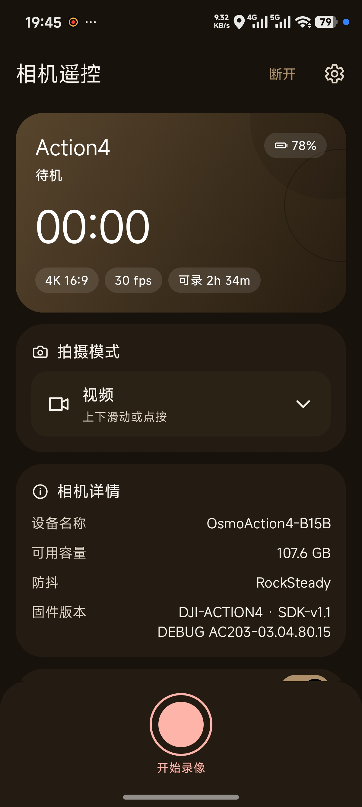

# Osmo Link

用手机通过蓝牙遥控 DJI Osmo 相机，并把手机的 GPS 定位发给相机。Android 与 iOS 都是原生应用，共用 Rust BLE 核心。支持 Osmo Action 4、5 Pro、6 和 Osmo 360，功能随型号和固件而异。

**[下载最新版本](https://github.com/CakeAL/osmo-link-rs/releases/latest)** · [更新日志](CHANGELOG.md)

## 安装

| 版本 | 系统和安装方式 |
| --- | --- |
| **Android** | Android 10 及以上，下载已签名的 arm64 APK。支持连接常驻通知，兼容的 Android 16+ 设备可显示录制 Live Update。 |
| **iOS** | iOS 16 及以上，下载未签名的 IPA 后侧载。iOS 16.1 起支持录制实时活动，兼容机型可在灵动岛查看。 |

### iOS 侧载

用 Mac 或 Windows 上的 `AltServer`/`Sideloadly` 之类的软件 打开 IPA，连接 iPhone，并用自己的 Apple 账号签名安装。按提示在 iPhone 上开启开发者模式并信任开发者。使用免费账号侧载后，每 7 天需要续签。[详细步骤](docs/ios.md#侧载)

## 功能

- **蓝牙遥控**支持搜索相机、自动连接上次配对的相机、拍照、启停录像和切换模式，并显示电量、温度和存储。
- **GPS 定位下发**需要手机定位权限。连接后在遥控页打开「定位注入」，App 默认每 100 ms 发送最近一次有效定位。相机能否将定位写入视频取决于机型和固件。iOS 按协议发送卫星数 `0`，表示系统未提供该数据。
- **提醒与更新**包括低电量、高温提醒和最近操作记录。设置页可以手动检查 GitHub Release。

## crates

* osmo-core: 一个最小的 Rust 核心库，提供蓝牙连接、相机协议、GPS 注入等功能。
* macos-cli: 实现了 osmo-core，用来在 macOS 上测试连接 action4 使用的。
* mobile-bridge: 使用 uniffi 生成的 Rust 与 Android/iOS 原生代码桥接库，用来给 Android 和 iOS 项目使用。
* osmo-gps-extract-gpx: 从 DJI Osmo Action 4 / 5 / 6 的 MP4 中读取内嵌 GPS，写成 GPX。

## 文档

[Android](docs/android.md) · [iOS](docs/ios.md) · [构建、CLI 与 Rust 接入](docs/development.md) · [发布与签名](docs/release.md) · [视频 GPS 提取为 GPX](crates/osmo-gps-extract-gpx/README.md)
